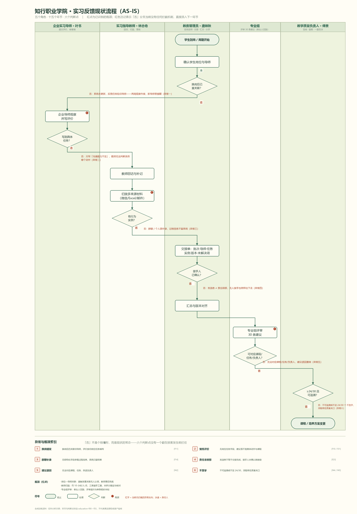

# 教育 · 实习管理与教学改进

> 以知行职业学院「实习反馈里的能力缺口」为样本的业务调研、需求挖掘与 FDE 全流程训练记录。

> ⚠️ 本仓库内容基于**合成场景访谈**整理，结论均为**待验证假设**，不代表真实客户授权、生产上线或实际收益。

[](LICENSE)

## 一句话结论

客户以为问题在「整理慢」，实际病根在三处：**换岗后反馈发错人**、**企业说不出哪个岗位任务没做好**、**改进建议落不到具体课程**。这三处不修，整理得越快，糊涂账抄得越整齐。

## 目录结构

```
education/
├── README.md                     # 本文件：项目概览与文档索引
├── LICENSE                       # MIT 协议
├── docs/                         # 业务文档（调研、挖掘、训练记录）
│   ├── discovery-report.md
│   ├── education-fde-training.md
│   ├── 实习管理与教学改进-业务挖掘报告.md
│   ├── 实习管理与教学改进-现场调研报告.md
│   ├── 知行职业学院-实习反馈里的能力缺口-四份可核对资料.html
│   └── 现状流程图.png
└── src/                          # 代码（当前为占位，后续补充）
```

## 文档索引

| 文档 | 内容 |
| --- | --- |
| [`docs/discovery-report.md`](docs/discovery-report.md) | 业务需求发现报告：36 项调查覆盖 35 项，输出 6 条候选需求（P0/P1）与验证下一步 |
| [`docs/education-fde-training.md`](docs/education-fde-training.md) | FDE 九阶段全流程训练记录（业务挖掘 → 运营迭代）、ROI 测算、业务流程与 Ontology 对象图、成果追溯 |
| [`docs/实习管理与教学改进-业务挖掘报告.md`](docs/实习管理与教学改进-业务挖掘报告.md) | 业务挖掘：触发事件、机会清单、硬边界、验收门槛与待补事项 |
| [`docs/实习管理与教学改进-现场调研报告.md`](docs/实习管理与教学改进-现场调研报告.md) | 现场调研：六类角色访谈地图、四来源收敛、矛盾与断点 |
| [`docs/知行职业学院-实习反馈里的能力缺口-四份可核对资料.html`](docs/知行职业学院-实习反馈里的能力缺口-四份可核对资料.html) | 客户诉求、现状信息流、业务角色访谈要点、资料核对清单（单页 HTML） |
| [`docs/现状流程图.png`](docs/现状流程图.png) | 现状业务流程与信息流示意 |

## 现状流程图



## 背景与基线

- 每学期约 **600 名**学生实习，反馈完整率 **54%**，目标 **85%**（访谈口径，须按样本验证）
- 每位教师带 **30 人**，每月约 **10 小时**整理微信、Excel、邮件等多来源反馈（时效/返工/复核三项成本尚无可用基线）
- 教师写建议、变更培养方案需教务委员会审批；**模型不决定成绩**，**不做成绩写回**
- 试点范围：机电专业 + 5 家企业，先历史回放、再并行试点，不关停现有人工流程

## 验收门槛

- 专业组审阅 **30 条建议，至少 24 条**可对应到课程、岗位任务与改进负责人
- 复测「反馈完整率 85%、24/30 可执行」后才更新规则；分母、统计周期与排除规则由业务负责人固定
- 出现换岗、无行为实例、口径不一致、依据缺失或系统不可用时，**停止自动建议**并转人工确认

## 本地使用

```bash
git clone https://github.com/<owner>/education.git
cd education
```

文档为 Markdown，可直接在 GitHub 或任意 Markdown 编辑器中阅读；`docs/…html` 用浏览器打开即可。

## 贡献

1. 文档改动请保持「事实 / 假设 / 待核实」三类标记不混用；
2. 引用访谈证据时保留编号（如 `education-f42`）与来源；
3. 涉及学生个人信息的样例一律脱敏。

## 许可

本项目采用 [MIT License](LICENSE) 发布。
