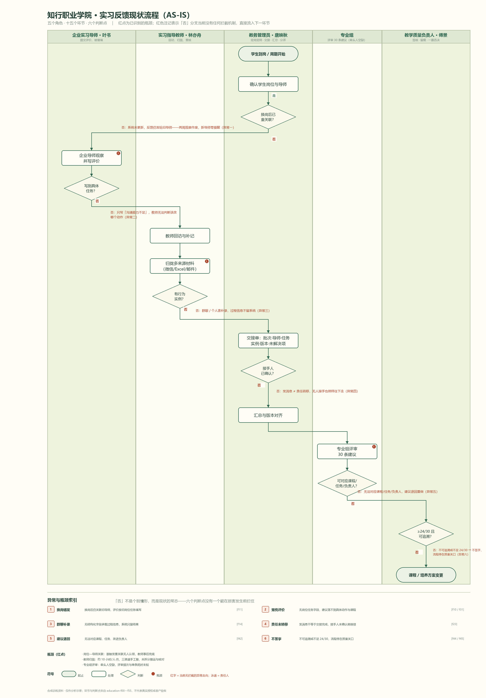

# 教育 · 实习管理与教学改进

> 以知行职业学院「实习反馈里的能力缺口」为样本的业务调研、需求挖掘与 FDE 全流程训练记录。

> ⚠️ 本仓库内容基于**合成场景访谈**整理，结论均为**待验证假设**，不代表真实客户授权、生产上线或实际收益。

[](LICENSE)

## 一句话结论

客户以为问题在「整理慢」，实际病根在三处：**换岗后反馈发错人**、**企业说不出哪个岗位任务没做好**、**改进建议落不到具体课程**。这三处不修，整理得越快，糊涂账抄得越整齐。

## 可运行的 MVP

`src/` 下是可直接启动的服务：FastAPI 接口 + 知识库检索与知识图谱 + 分层权限 + 审计链 + 单页前端，
模型层可选接本地 Ollama（默认走确定性规则，不装模型也能演示）。

```bash
cd src
./run.ps1     # Windows：自动准备环境、构建索引，并打开 http://127.0.0.1:8010
# 或
docker build -t learning-support-mvp . && docker run -p 8000:8000 learning-support-mvp
```

演示账号：`teacher/teacher123`（起草）、`reviewer/review123`（确认）、`admin/admin123`（管理）、
`student/student123`（只读）。端到端测试：`python tests/harness.py`，当前 30/30 通过。

## 目录结构

```
education/
├── README.md                       # 本文件：项目概览与文档索引
├── LICENSE                         # MIT 协议
├── PROMPT-智能体开发.md             # v5 编码提示词：受控执行系统规格（模型/知识库/权限/红线）
├── docs/                           # 业务文档（调研、挖掘、方案、训练记录）
│   ├── discovery-report.md
│   ├── education-fde-training.md
│   ├── 实习管理与教学改进-业务挖掘报告.md
│   ├── 实习管理与教学改进-现场调研报告.md
│   ├── 技术方案-实习反馈整理系统.md
│   ├── 技术方案-实习反馈整理系统.docx
│   ├── 提示词-模板版.md
│   ├── 知行职业学院-实习反馈里的能力缺口-四份可核对资料.html
│   └── 现状流程图.png
├── src/                            # 可运行的 MVP（FastAPI · 知识库 · 分层权限 · 单页前端）
└── tools/                          # 文档构建与校验脚本
```

## 文档索引

| 文档 | 内容 |
| --- | --- |
| [`PROMPT-智能体开发.md`](PROMPT-智能体开发.md) | v5 编码提示词：受控执行系统的元规则、事实清单、技术栈、权限分层与红线（Ollama + Qwen3-8B） |
| [`docs/discovery-report.md`](docs/discovery-report.md) | 业务需求发现报告：36 项调查覆盖 35 项，输出 6 条候选需求（P0/P1）与验证下一步 |
| [`docs/education-fde-training.md`](docs/education-fde-training.md) | FDE 九阶段全流程训练记录（业务挖掘 → 运营迭代）、ROI 测算、业务流程与 Ontology 对象图、成果追溯 |
| [`docs/实习管理与教学改进-业务挖掘报告.md`](docs/实习管理与教学改进-业务挖掘报告.md) | 业务挖掘：触发事件、机会清单、硬边界、验收门槛与待补事项 |
| [`docs/实习管理与教学改进-现场调研报告.md`](docs/实习管理与教学改进-现场调研报告.md) | 现场调研：六类角色访谈地图、四来源收敛、矛盾与断点 |
| [`docs/技术方案-实习反馈整理系统.md`](docs/技术方案-实习反馈整理系统.md) | 技术方案：FastAPI 服务、知识库与知识图谱、分级权限、部署与验收（同目录 `.docx` 为排版版） |
| [`docs/提示词-模板版.md`](docs/提示词-模板版.md) | 可复用的提示词模板（字段、闸门、审计要求） |
| [`docs/知行职业学院-实习反馈里的能力缺口-四份可核对资料.html`](docs/知行职业学院-实习反馈里的能力缺口-四份可核对资料.html) | 客户诉求、现状信息流、业务角色访谈要点、资料核对清单（单页 HTML） |
| [`docs/现状流程图.png`](docs/现状流程图.png) | 现状业务流程与信息流示意 |
| [`docs/算力成本与TCO.md`](docs/算力成本与TCO.md) | API / 云租 / 自购三年总账、电费与盈亏平衡点 |
| [`docs/案例分析.md`](docs/案例分析.md) | 四笔账对照与报价五版复盘 |
| [`docs/报价包总装.md`](docs/报价包总装.md) | 六件产出清单、10 项数字咬合校验、5 分钟路演脚本 |
| [`docs/报价包咬合校验表.md`](docs/报价包咬合校验表.md) | 课件的 6 项咬合校验、修正记录与复算命令 |
| [`docs/项目一页纸.md`](docs/项目一页纸.md) | 开课前五项：客户 / 用量 / 数据 / 上云条件 |
| [`docs/人天单价推导.md`](docs/人天单价推导.md) | 人天单价：正式员工 2,450；实习生＋导师复核混合 990（本项目采用） |
| [`docs/成本拆解与报价.md`](docs/成本拆解与报价.md) | 五块成本拆解（可复算）与组合报价结构、四模式取舍 |
| [`docs/使用场景与调用量.md`](docs/使用场景与调用量.md) | 六类模型调用：生成 / 追问 / 企业填写 / 自检 / 重试 / 回放 |
| [`docs/Token月成本测算.md`](docs/Token月成本测算.md) | 六场景合计 6.2M token/月，预算 100 元/月 |
| [`docs/部署方案对比.md`](docs/部署方案对比.md) | API / 自建 / 混合三方案、盈亏平衡与显存实算 |
| [`docs/客户ROI一页纸.md`](docs/客户ROI一页纸.md) | 四类收益、回本 1.65 年、敏感性分析 |
| [`docs/正式报价单.md`](docs/正式报价单.md) | 首年 85,675、付款节点、SLA、谈判底线 |
| [`docs/开源协作-Issue与PR流程.md`](docs/开源协作-Issue与PR流程.md) | 开源协作：Fork / 分支 / Issue 查重 / PR 描述与自查清单，含本项目实例 |

## 现状流程图



## 背景与基线

- 每学期约 **600 名**学生实习，反馈完整率 **54%**，目标 **85%**（访谈口径，须按样本验证）
- 每位教师带 **30 人**，每月约 **10 小时**整理微信、Excel、邮件等多来源反馈（时效/返工/复核三项成本尚无可用基线）
- 教师写建议、变更培养方案需教务委员会审批；**模型不决定成绩**，**不做成绩写回**
- 试点范围：机电专业 + 5 家企业，先历史回放、再并行试点，不关停现有人工流程

## 验收门槛

- 专业组审阅 **30 条建议，至少 24 条**可对应到课程、岗位任务与改进负责人
- 复测「反馈完整率 85%、24/30 可执行」后才更新规则；分母、统计周期与排除规则由业务负责人固定
- 出现换岗、无行为实例、口径不一致、依据缺失或系统不可用时，**停止自动建议**并转人工确认

## 本地使用

```bash
git clone https://github.com/<owner>/education.git
cd education
```

文档为 Markdown，可直接在 GitHub 或任意 Markdown 编辑器中阅读；`docs/…html` 用浏览器打开即可。

## 贡献

1. 文档改动请保持「事实 / 假设 / 待核实」三类标记不混用；
2. 引用访谈证据时保留编号（如 `education-f42`）与来源；
3. 涉及学生个人信息的样例一律脱敏。

## 许可

本项目采用 [MIT License](LICENSE) 发布。
