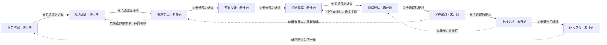
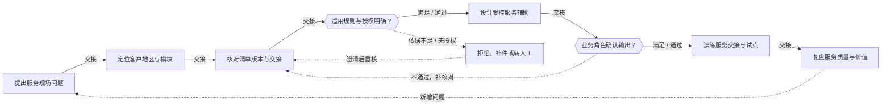
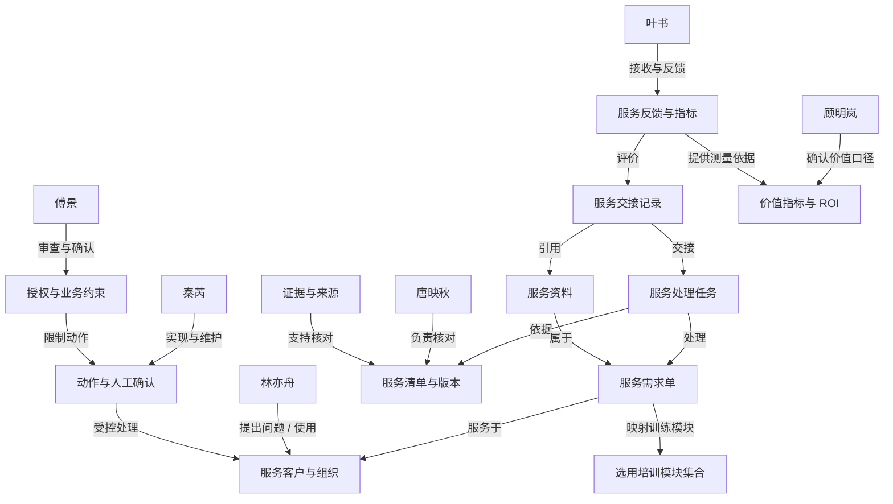

# 实习管理与教学改进 · 项目练习 1

## 当前实践模块

- 实习管理与教学改进（education）

## 项目可选模块

- 实习管理与教学改进（education）

## 模块已访谈证据（待核实）

- [education / education-f00] 顾明岚：每学期 600 名学生实习，反馈完整率 54%，目标 85%；要找到可行动的课程改进。
- [education / education-f01] 顾明岚：企业评分 → 教师回访 → 教务汇总 → 专业组评审，但建议常没有落到具体课程。
- [education / education-f12] 林亦舟：每位教师带 30 人，每月花约 10 小时整理多份微信、Excel 和邮件。
- [education / education-f10] 林亦舟：企业只写“沟通能力不足”，不知道发生在哪个岗位任务，无法指导学生改进。
- [education / education-f22] 唐映秋：教师可以写建议，变更培养方案需教务委员会审批，模型不能决定学生成绩。
- [education / education-f24] 唐映秋：规则由业务负责人维护，保存生效日期与适用范围。对学生换岗、企业评价没有行为实例或评分口径不一致产生的争议，需要记录使用版本并由教学质量负责人确认。
- [education / education-f30] 秦芮：学籍、实习和课程平台使用不同 ID，需要先建立学生与实习批次映射。
- [education / education-f32] 秦芮：仅开放只读批量导出，成绩写回接口不在本次范围。
- [education / education-f40] 傅景：学生个人评价应限制访问范围，不能向其他企业公开个体记录。
- [education / education-f41] 傅景：能力推断必须有行为实例；不以家庭背景、性别等信息解释能力。
- [education / education-f51] 叶书：企业重视设备点检与交接，学校评价更偏理论，任务口径需共同校准。
- [education / education-f53] 叶书：各部门的完成时间要分别记录。反馈完整率 85%，30 条建议至少 24 条可执行 的分母、统计周期和排除规则由业务负责人固定，不能用消息发送量代替实际完成量。
- [education / education-f02] 顾明岚：先选机电专业，覆盖 5 家企业，比较建议可执行性和教师整理工时。
- [education / education-f05] 顾明岚：首期只覆盖机电专业和 5 家企业的实习反馈。先历史回放、再并行试点，不能直接关掉现有人工流程。
- [education / education-f03] 顾明岚：本次合成试点预算为 12 万元，需要扣除接口、培训、复核和维护成本；既有系统采购不纳入节省额。
- [education / education-f04] 顾明岚：业务立项由产教融合负责人牵头，教学质量负责人有风险否决权，企业实习导师参与交接结果验收。
- [education / education-f14] 林亦舟：遇到学生换岗、企业评价没有行为实例或评分口径不一致时，同事会在群聊或个人表里补充说明，再回系统补录。关键原因目前没有作为结构化字段随业务交接。
- [education / education-f13] 林亦舟：在机电专业和 5 家企业的实习反馈现场，使用现有终端；需要保留待补信息和最后同步时间，不能要求一线重复登录多个系统才能办完一项业务。
- [education / education-f15] 林亦舟：每条辅助结果必须显示原记录。涉及学生换岗、企业评价没有行为实例或评分口径不一致时，先由教务管理员核对；未经确认的结果不能覆盖原记录。
- [education / education-f11] 林亦舟：学生有换岗与延期，系统仍关联旧导师，导致反馈发给错误的人。
- [education / education-f20] 唐映秋：先确认学生岗位与导师，再收集任务表现、事实例子和改进建议，最后专业组确认。
- [education / education-f23] 唐映秋：交接要带学生批次、导师身份、岗位任务与企业反馈实例、当前版本和未解决事项。接手人明确确认后才结束本岗待办，发送消息不等于责任已转移。
- [education / education-f25] 唐映秋：我分派异常时要写明处理人、截止时间与退回原因，超时交给产教融合负责人协调；不能只把状态改成“已转交”。
- [education / education-f31] 秦芮：历史反馈缺少岗位任务字段，先做模板补齐，不能把空值当作没问题。
- [education / education-f33] 秦芮：学生批次、导师身份、岗位任务与企业反馈实例需要校验主编号、事件时间、来源和版本；缺少关键字段进入人工修复队列，不用猜测值补齐。
- [education / education-f35] 秦芮：接口失败时继续原人工流程，保留只读快照与时间戳；恢复后按业务编号去重补齐，不能重复创建同一待办。
- [education / education-f34] 秦芮：试点数据按每两周一次刷新，原文按版本同步。超过一个周期的结果标注待刷新；历史快照不能伪装成当前状态。
- [education / education-f42] 傅景：专业组审阅 30 条建议，至少 24 条可对应课程、任务和改进负责人。
- [education / education-f44] 傅景：出现学生换岗、企业评价没有行为实例或评分口径不一致、依据缺失或关键系统不可用时，停止自动建议并标明原因、接手人及人工确认时间。
- [education / education-f45] 傅景：审核日志保留学生批次、导师身份、岗位任务与企业反馈实例的版本、建议内容、人工修正与签核人，能重建当次处理；不记录口令或非必要个人信息。
- [education / education-f43] 傅景：本轮合成试点评价记录暂留 90 天，到期由教学质量负责人确认删除或归档；真实组织的资料留存期限需另行核实。
- [education / education-f52] 叶书：AI 可整理观察事实与建议，最终评价由导师确认，不自动给学生定性。
- [education / education-f50] 叶书：我需要每两周提交一次具体任务例子，长问卷会拖到学期结束才填。
- [education / education-f55] 叶书：每周复盘与机电专业和 5 家企业的实习反馈相关的误判和未解决问题，由产教融合负责人指定改进负责人，复测“反馈完整率 85%，30 条建议至少 24 条可执行”后才更新规则。
- [education / education-f54] 叶书：下游反馈必须关联原业务编号和当时的资料版本；由企业实习导师受理，教务管理员核实，未确认前不承诺赔偿或结果。

# FDE 全流程训练记录

项目：实习管理与教学改进

训练者填写的任务和角色评审记录；不自动证明真实客户授权、生产上线或实际收益。

## 1. 业务挖掘

从经营目标、真实事件和指标基线中判断是否值得立项。

### 识别业务机会

交付：业务机会清单

状态：已完成 · 责任人：当前练习者

证据：当前练习访谈与案例资料

口径固定 → 岗位任务模板 → 换岗交接与重关联 → 双周节拍 → 受限 AI 整理（带 24/30 与追溯） → 只读 ID 映射 → 暂缓课程台账 → 不做自动评价/成绩写回。

一句话：客户以为病在“整理慢”，实际病在换岗发错人、企业说不出哪个活没干好、建议落不到课。 这三处不修，整理得越快，糊涂账抄得越整齐。

### 建立现状基线

交付：指标基线与价值假设

状态：进行中 · 责任人：当前练习者

证据：当前练习访谈与案例资料

三项成本目前 0 项可用：时效无任何时点、返工无计数、复核无耗时。唯一数字是“每月约 10 小时”（f12），且未拆开搬运与核对——这个比例决定 AI 是省钱还是添活。顾明岚已提示“如果拿不到可对照的旧反馈，建议可执行性就没法比较”。这是方法学前提，不是数据——回放前必须先确认旧反馈可得，否则 24/30 将无对照。

### 确认立项与决策链

交付：项目章程与利益相关者地图

状态：进行中 · 责任人：当前练习者

证据：当前练习访谈与案例资料

顾老师张罗，傅老师能否决（他不签字，做出来也没人认），钱还差一个签字的人。立项书先写死三个名字：谁批钱、谁验收、出事找谁。只答应做小试验，别答应改造系统。

关卡：业务负责人确认问题、指标口径与调查范围

{"status":"待确认"}

## 2. 现场调研

还原实际流程，用多角色和多来源材料核实问题。

### 开展角色访谈

交付：访谈记录与角色地图

状态：已完成 · 责任人：当前练习者

证据：当前练习访谈与案例资料

唯一缺口是唐映秋“可提供哪些材料、模板或证据”——她四次回答都只给材料类别（批次清单、导师对应、岗位任务记录、反馈实例、版本与未解决事项登记表），始终没给出一份现成模板。这本身就是一条结论：交接材料目前只存在于口头约定里

### 还原现状流程

交付：现状流程图与异常路径

状态：进行中 · 责任人：当前练习者

证据：当前练习访谈与案例资料

主链画得出来，但定岗定师、交接、汇总对齐、专业组评审这四个环节没有任何单据实物；五类异常里，只有换岗延期有实例，其余四类只有规则没有案例。

### 四来源收敛与材料核对

交付：四来源收敛表、证据台账与问题清单

状态：已完成 · 责任人：当前练习者

证据：当前练习访谈与案例资料

岗位任务字段缺失：Buyer 说建议落不到课↔ Operator 说不知道改哪个动作↔ 企业说口径要校准↔ 数据说历史反馈缺这个字段。四个方向指向同一处。
换岗交接断点：Operator 的错发↔ 教务的交接要求↔ 企业的任务口径，都缺同一件东西：带批次、导师、任务、版本、未解决项的结构化交接。
可追溯即验收：傅景的 24/30与“每条须点回原记录”、“日志能重建”一致，验收可判、可写死。

关卡：关键流程、异常、证据矛盾和待核实项已形成记录

{"status":"待确认"}

## 3. 需求定义

把调查发现收敛为有证据、可验收、可追责的需求。

### 确定优先问题

交付：问题优先级与机会判断

状态：未开始 · 责任人：未填写

证据：未填写

尚无训练记录

### 编写需求与边界

交付：需求规格与追溯矩阵

状态：未开始 · 责任人：未填写

证据：未填写

尚无训练记录

### 约定验收标准

交付：验收清单与需求确认记录

状态：未开始 · 责任人：未填写

证据：未填写

尚无训练记录

关卡：问题优先级、需求范围和可测验收条件均有确认记录

{"status":"待确认"}

## 4. 方案设计

以最小试点验证价值，设计数据、系统和人工控制。

### 选定最小试点

交付：试点方案与方案比较

状态：未开始 · 责任人：未填写

证据：未填写

尚无训练记录

### 设计数据和系统边界

交付：架构图、数据与权限矩阵

状态：未开始 · 责任人：未填写

证据：未填写

尚无训练记录

### 报价与投入产出测算

交付：项目报价、首年ROI测算与实施评估计划

状态：未开始 · 责任人：未填写

证据：未填写

尚无训练记录

关卡：试点边界、方案取舍、数据权限与实施计划已评审

{"status":"待确认"}

## 5. 构建集成

实现可运行的最小闭环，使规则、模型与人工责任可追溯。

### 落实数据与工具契约

交付：数据契约与集成记录

状态：未开始 · 责任人：未填写

证据：未填写

尚无训练记录

### 实现业务闭环

交付：原型代码与版本说明

状态：未开始 · 责任人：未填写

证据：未填写

尚无训练记录

### 实现异常与审计

交付：异常处理与审计样例

状态：未开始 · 责任人：未填写

证据：未填写

尚无训练记录

关卡：指定版本可复现运行，异常和人工交接路径完整

{"status":"待确认"}

## 6. 测试评估

证明行为与需求一致，区分模拟验证、真实模型验证与业务验收。

### 建立评估集合

交付：评估集与需求覆盖表

状态：未开始 · 责任人：未填写

证据：未填写

尚无训练记录

### 执行测试与重复评估

交付：测试报告与评估结果

状态：未开始 · 责任人：未填写

证据：未填写

尚无训练记录

### 修复并回归确认

交付：缺陷闭环与质量结论

状态：未开始 · 责任人：未填写

证据：未填写

尚无训练记录

关卡：评估范围、版本、失败项、修复复测与剩余风险可审查

{"status":"待确认"}

## 7. 客户试点

在受控范围中验证实际采用和业务收益。

### 准备受控试点

交付：试点执行计划

状态：未开始 · 责任人：未填写

证据：未填写

尚无训练记录

### 开展用户验收

交付：用户验收与反馈记录

状态：未开始 · 责任人：未填写

证据：未填写

尚无训练记录

### 核对价值与继续决定

交付：试点收益复核与决策纪要

状态：未开始 · 责任人：未填写

证据：未填写

尚无训练记录

关卡：试点对照、用户反馈、退出条件与扩大范围决定有记录

{"status":"待确认"}

## 8. 上线交接

把通过试点的版本交给具名负责人，明确上线和回退责任。

### 审查上线准备

交付：上线准备检查与三方评审

状态：未开始 · 责任人：未填写

证据：未填写

尚无训练记录

### 演练发布与回滚

交付：发布计划与回滚演练记录

状态：未开始 · 责任人：未填写

证据：未填写

尚无训练记录

### 完成运维和用户交接

交付：交接清单、运行手册与签收记录

状态：未开始 · 责任人：未填写

证据：未填写

尚无训练记录

关卡：业务、技术和风险角色的上线准备及交接决定有依据

{"status":"待确认"}

## 9. 运营迭代

持续观察价值、质量和成本，形成下一轮业务发现。

### 建立持续运营节奏

交付：30/60/90天运营计划

状态：未开始 · 责任人：未填写

证据：未填写

尚无训练记录

### 演练事件与变更管理

交付：事件复盘与变更记录

状态：未开始 · 责任人：未填写

证据：未填写

尚无训练记录

### 复盘并启动下一轮发现

交付：项目复盘、迭代清单与作品集

状态：未开始 · 责任人：未填写

证据：未填写

尚无训练记录

关卡：运营节奏、事件闭环、复盘及下一轮优先级已确认

{"status":"待确认"}

# FDE阶段成果与追溯

项目：实习管理与教学改进
练习：4c2bd139-1bd0-44de-89c3-d9f8708b1108

- 报告 REPORT-e4990d40-b712-4a04-bc9f-f4d868a62b5f v1：知行职业学院 · 业务需求发现报告

## 业务挖掘 · stale

成果：ART-74aab902-e988-4ff1-b000-89bcc6bb9164 v1

输入：REPORT-e4990d40-b712-4a04-bc9f-f4d868a62b5f v1

围绕实习管理与教学改进整理业务挖掘。以下为基于已保存输入的待完善草稿。

### 业务机会清单

上游输入：知行职业学院 · 业务需求发现报告 v1：现有事实已能定位主要瓶颈：企业反馈笼统且缺少岗位任务维度，教师整理成本高，异常换岗与评分口径不一致靠群聊补录，系统间ID未映射且历史反馈缺岗位任务字段。切入点应优先放在“岗位任务关联的反馈模板+人工确认的整理建议”，而非自动评价或成绩写回。验收口径已有硬线（30条建议至少24条可对应课程、任务与改进负责人），但字段清单、口径责任人、异常接手人、投诉时限等尚未核实，需通过后续访谈补齐。

本步整理：收集最近一次异常事件，区分客户提出的功能和真正要改善的业务结果。

待明确：哪个具体事件触发了需求？如果维持现状，会产生什么损失？
边界：只读核对与人工交接；合成训练不代表真实授权、业务执行或客户验收

引用：education-f10、education-f31、education-f51、education-f50、education-f00、education-f12、education-f11、education-f14、education-f23、education-f25、education-f30、education-f32、education-f33、education-f34、education-f35、education-f41、education-f15、education-f45、education-f44、education-f52、education-f53、education-f24、education-f42

### 指标基线与价值假设

上游输入：知行职业学院 · 业务需求发现报告 v1：现有事实已能定位主要瓶颈：企业反馈笼统且缺少岗位任务维度，教师整理成本高，异常换岗与评分口径不一致靠群聊补录，系统间ID未映射且历史反馈缺岗位任务字段。切入点应优先放在“岗位任务关联的反馈模板+人工确认的整理建议”，而非自动评价或成绩写回。验收口径已有硬线（30条建议至少24条可对应课程、任务与改进负责人），但字段清单、口径责任人、异常接手人、投诉时限等尚未核实，需通过后续访谈补齐。

本步整理：定义指标分子、分母、时间窗、样本来源和测量责任人，缺失数据列为待采集。

待明确：现状耗时、返工和错误如何计算？哪些数字还只是估计？
边界：只读核对与人工交接；合成训练不代表真实授权、业务执行或客户验收

引用：education-f10、education-f31、education-f51、education-f50、education-f00、education-f12、education-f11、education-f14、education-f23、education-f25、education-f30、education-f32、education-f33、education-f34、education-f35、education-f41、education-f15、education-f45、education-f44、education-f52、education-f53、education-f24、education-f42

### 项目章程与利益相关者地图

上游输入：知行职业学院 · 业务需求发现报告 v1：现有事实已能定位主要瓶颈：企业反馈笼统且缺少岗位任务维度，教师整理成本高，异常换岗与评分口径不一致靠群聊补录，系统间ID未映射且历史反馈缺岗位任务字段。切入点应优先放在“岗位任务关联的反馈模板+人工确认的整理建议”，而非自动评价或成绩写回。验收口径已有硬线（30条建议至少24条可对应课程、任务与改进负责人），但字段清单、口径责任人、异常接手人、投诉时限等尚未核实，需通过后续访谈补齐。

本步整理：明确业务发起人、使用者、出资者、审批者，记录访谈授权与调查边界。

待明确：谁承担结果？谁批准范围、数据访问及继续或停止？
边界：只读核对与人工交接；合成训练不代表真实授权、业务执行或客户验收

引用：education-f10、education-f31、education-f51、education-f50、education-f00、education-f12、education-f11、education-f14、education-f23、education-f25、education-f30、education-f32、education-f33、education-f34、education-f35、education-f41、education-f15、education-f45、education-f44、education-f52、education-f53、education-f24、education-f42

需求：
- REQ-1 以岗位任务为锚点重构反馈模板，是解决“沟通能力不足”类笼统评价的前置需求；负责人林亦舟（实习指导教师）与叶书（企业实习导师）共同确认；验收在机电专业选1家企业，用现有反馈样本试填含岗位任务、行为实例、改进建议的模板，统计可填比例与教师整理工时变化；由林亦舟与叶书共同确认字段是否够用。；依据education-f10、education-f31、education-f51
- REQ-2 双周短反馈机制比学期末长问卷更能提升反馈完整率；负责人顾明岚（产教融合负责人）牵头，叶书配合；验收在5家企业中选2家做4周双周反馈并行试点，记录提交率与教师整理工时，与现有人工流程对比；由顾明岚确认是否扩大。；依据education-f50、education-f00、education-f12
- REQ-3 异常换岗与导师关联错误需要结构化交接字段，而非群聊补录；负责人唐映秋（教务管理员）确认规则，秦芮提供数据支持；验收梳理近一学期换岗案例，列出当前补录字段与缺失字段，形成交接字段清单草案；由唐映秋确认分派责任人与超时协调路径。；依据education-f11、education-f14、education-f23、education-f25
- REQ-4 学生与实习批次ID映射及版本时间戳是分析可信度的前置条件；负责人秦芮（校园信息工程师）；验收先导出机电专业一个批次的只读数据，核对主编号、事件时间、来源、版本四项校验通过率；由秦芮出具映射表与待刷新标注样例。；依据education-f30、education-f32、education-f33、education-f34、education-f35
- REQ-5 AI整理结果必须保留原文追溯与人工确认，才能满足质量与审计要求；负责人傅景（教学质量负责人）行使确认权，唐映秋核对；验收用30条历史反馈做回放，检查每条建议能否追溯到原文与版本、是否标注人工确认人；由傅景按24/30硬线预审，未达标不进入试点。；依据education-f41、education-f15、education-f45、education-f44、education-f52
- REQ-6 评分口径与统计分母需业务负责人固定，否则验收数字不可比；负责人顾明岚固定口径，傅景确认风险边界；验收请顾明岚出具一页口径说明（分母、周期、排除规则、生效日期），与傅景确认后作为试点验收附件；先核对现有统计是否可复算。；依据education-f53、education-f24、education-f42

遗留项：书面Brief、行业可行性与现场测量是否已经核对？；本阶段责任人应补齐具体决定、执行证据与未解决事项。

确认：{"status":"待确认"}

## 现场调研 · missing

待生成；输入不足时先返回上游补齐。

## 需求定义 · missing

待生成；输入不足时先返回上游补齐。

## 方案设计 · missing

待生成；输入不足时先返回上游补齐。

## 构建集成 · missing

待生成；输入不足时先返回上游补齐。

## 测试评估 · missing

待生成；输入不足时先返回上游补齐。

## 客户试点 · missing

待生成；输入不足时先返回上游补齐。

## 上线交接 · missing

待生成；输入不足时先返回上游补齐。

## 运营迭代 · missing

待生成；输入不足时先返回上游补齐。

## 需求如何归纳

先从已采集事实形成问题假设，再约定业务结果、范围、失败控制和验收。缺少的来源标记待补，不能把六人访谈完整率当作四来源收敛或需求确认。

### 业务流程拆解

要回答：问题发生在哪一步，为什么要这样划分智能体？

1. 先画人工现状泳道，写出触发、输入、8–15个处理步骤、交接和异常。
2. 区分判断点与执行点；按使用的数据、权限、模型能力与失败方式组合执行步骤。
3. 在不可逆动作前设置确定性校验；为低置信、缺资料、冲突和越权安排具名人工接收人。

交付链：现状流程 → 失败方式 → 智能体/工具边界 → 校验与人工升级路径

原文：frameworks/workflow-decomposition.md

### 业务结果与不可逆风险矩阵

要回答：多个需求中，先做哪个最小可验证方案？

1. 列出3–5个候选切入点，分别说明改善的业务结果、现状基线和投入。
2. 评估失败何时被谁看见、能否在损害前拦截、是否可以撤销；不要把模型置信度等同于业务风险。
3. 优先选择高价值、可拦截且可恢复的切入点；高风险需硬约束和责任人否决权，价值或风险未知先补证据。

交付链：候选方案 → 价值/风险比较 → 选择与暂缓理由 → 验收指标与停止条件

原文：frameworks/outcome-risk-matrix.md

### 四来源收敛

要回答：谁说要做，哪里真的坏了，范围允许什么，技术是否可行？

1. Buyer：核实业务目标、预算、优先级和决定权；Operator：用最近一单还原真实操作和失败位置。
2. Brief：核对书面目标、范围、时间和排除项；Industry：寻找可比技术实践，并核实本项目的数据与接口差异。
3. 检查四个视角是否指向同一瓶颈。分歧保留在问题清单：一线帮助定位故障，决策者确认价值，Brief约束范围，行业证据帮助判断可行性。

交付链：四视角陈述与来源 → 收敛/分歧 → 待核实问题 → 有边界的需求假设

原文：frameworks/4-source-convergence.md

### 本次四来源核对

- Buyer · 业务决策者：顾明岚
  状态：已采集角色陈述，目标和预算仍待确认；已采集依据：education-f00、education-f01、education-f02、education-f05、education-f03、education-f04
- Brief · 书面需求：企业说学生能力不够，老师觉得评价太笼统。希望用 AI 整理实习反馈、发现教学改进需求，你先帮我们开展一次调研。
  状态：当前只有场景开场；书面Brief原文与版本待补；已采集依据：暂无
- Industry · 行业可行性：需要可比技术案例、数据条件和接口能力的核验材料。企业业务介绍不能证明技术可行。
  状态：待补行业实践与本项目适用性验证；已采集依据：暂无
- Operator · 一线使用者：林亦舟
  状态：已采集现场陈述，仍需样本与操作观察核实；已采集依据：education-f12、education-f10、education-f14、education-f13、education-f15、education-f11

### 从证据到候选需求

- REQ-1 以岗位任务为锚点重构反馈模板，是解决“沟通能力不足”类笼统评价的前置需求
  依据：education-f10、education-f31、education-f51
  推导：企业只写笼统评价、无法定位岗位任务（education-f10），历史反馈缺岗位任务字段且不能把空值当没问题（education-f31），企业侧与学校侧任务口径不一致（education-f51）。因此先补模板字段比先做AI分析更基础；但字段清单与缺失率尚未核实。
  判断：候选需求；需用结果与不可逆风险矩阵比较，P0/P1/P2不等于已完成价值风险评分。
  下一步：在机电专业选1家企业，用现有反馈样本试填含岗位任务、行为实例、改进建议的模板，统计可填比例与教师整理工时变化；由林亦舟与叶书共同确认字段是否够用。
- REQ-2 双周短反馈机制比学期末长问卷更能提升反馈完整率
  依据：education-f50、education-f00、education-f12
  推导：企业导师明确长问卷会拖到学期末才填，双周提交具体任务例子才收得上（education-f50）；当前完整率54%距目标85%有差距（education-f00），教师每月约10小时整理多来源材料（education-f12）。但双周节奏与教师现有30人负荷是否匹配尚未验证。
  判断：候选需求；需用结果与不可逆风险矩阵比较，P0/P1/P2不等于已完成价值风险评分。
  下一步：在5家企业中选2家做4周双周反馈并行试点，记录提交率与教师整理工时，与现有人工流程对比；由顾明岚确认是否扩大。
- REQ-3 异常换岗与导师关联错误需要结构化交接字段，而非群聊补录
  依据：education-f11、education-f14、education-f23、education-f25
  推导：学生换岗后系统仍关联旧导师导致反馈发错人（education-f11），同事在群聊或个人表补录再回系统（education-f14），交接需带批次、导师身份、未解决事项且接手人确认才结束（education-f23），分派异常要写明处理人、截止时间与退回原因（education-f25）。但异常触发责任人与时限尚未核实。
  判断：候选需求；需用结果与不可逆风险矩阵比较，P0/P1/P2不等于已完成价值风险评分。
  下一步：梳理近一学期换岗案例，列出当前补录字段与缺失字段，形成交接字段清单草案；由唐映秋确认分派责任人与超时协调路径。
- REQ-4 学生与实习批次ID映射及版本时间戳是分析可信度的前置条件
  依据：education-f30、education-f32、education-f33、education-f34、education-f35
  推导：学籍、实习、课程平台使用不同ID需先建映射（education-f30），仅开放只读批量导出、成绩写回不在范围（education-f32），关键字段缺失进人工修复队列不猜测补齐（education-f33），双周刷新且超周期标注待刷新（education-f34），故障时保留快照并按业务编号去重（education-f35）。但字段清单与缺失率未核实。
  判断：候选需求；需用结果与不可逆风险矩阵比较，P0/P1/P2不等于已完成价值风险评分。
  下一步：先导出机电专业一个批次的只读数据，核对主编号、事件时间、来源、版本四项校验通过率；由秦芮出具映射表与待刷新标注样例。
- REQ-5 AI整理结果必须保留原文追溯与人工确认，才能满足质量与审计要求
  依据：education-f41、education-f15、education-f45、education-f44、education-f52
  推导：能力推断必须有行为实例、不以家庭背景等解释（education-f41），每条辅助结果须显示原记录且未经确认不能覆盖原记录（education-f15），审核日志要能重建当次处理并排除口令与非必要个人信息（education-f45），依据缺失或口径不一致时停止自动建议并标明接手人（education-f44），AI只整理事实与建议、最终评价由导师确认（education-f52）。但留痕形式与查阅权限尚未核实。
  判断：候选需求；需用结果与不可逆风险矩阵比较，P0/P1/P2不等于已完成价值风险评分。
  下一步：用30条历史反馈做回放，检查每条建议能否追溯到原文与版本、是否标注人工确认人；由傅景按24/30硬线预审，未达标不进入试点。
- REQ-6 评分口径与统计分母需业务负责人固定，否则验收数字不可比
  依据：education-f53、education-f24、education-f42
  推导：完整率85%与30条建议24条可执行的分母、周期、排除规则须由业务负责人固定，不能用消息发送量代替实际完成量（education-f53）；规则由业务负责人维护并保存生效日期与适用范围，争议需记录版本并由教学质量负责人确认（education-f24）；验收要求专业组审阅30条至少24条可对应课程、任务与改进负责人（education-f42）。但当前口径文件是否存在尚未核实。
  判断：候选需求；需用结果与不可逆风险矩阵比较，P0/P1/P2不等于已完成价值风险评分。
  下一步：请顾明岚出具一页口径说明（分母、周期、排除规则、生效日期），与傅景确认后作为试点验收附件；先核对现有统计是否可复算。

## Demo执行证据

尚未执行绑定Demo评估。

## 阶段练习与训练评分

## 历史版本

保留0个旧版本。JSON导出包含原始报告、成果版本和完整输入引用。

# 实习管理与教学改进 · ROI测算

尚未保存ROI测算。

# 实习管理与教学改进 · FDE业务流程与Ontology

练习：项目练习 1

阶段进度与关卡来自本次练习；业务流程与对象关系为建模定义，不代表实际业务已经执行。

对象生命周期：服务任务：提出 → 待核实 → 待确认 → 已交接；未结项继续跟踪

选用模块：
- 实习管理与教学改进（education）

## FDE 项目处理流程

九阶段主线、阶段关卡和返工路径。完成与通过状态来自本次练习记录。

### 业务挖掘 · FDE阶段

从经营目标、真实事件和指标基线中判断是否值得立项。

关联阶段：业务挖掘

本次状态：进行中 · 1/3项任务

关卡：业务负责人确认问题、指标口径与调查范围

- 业务机会清单
- 指标基线与价值假设
- 项目章程与利益相关者地图

### 现场调研 · FDE阶段

还原实际流程，用多角色和多来源材料核实问题。

关联阶段：现场调研

本次状态：进行中 · 2/3项任务

关卡：关键流程、异常、证据矛盾和待核实项已形成记录

- 访谈记录与角色地图
- 现状流程图与异常路径
- 四来源收敛表、证据台账与问题清单

### 需求定义 · FDE阶段

把调查发现收敛为有证据、可验收、可追责的需求。

关联阶段：需求定义

本次状态：未开始 · 0/3项任务

关卡：问题优先级、需求范围和可测验收条件均有确认记录

- 问题优先级与机会判断
- 需求规格与追溯矩阵
- 验收清单与需求确认记录

### 方案设计 · FDE阶段

以最小试点验证价值，设计数据、系统和人工控制。

关联阶段：方案设计

本次状态：未开始 · 0/3项任务

关卡：试点边界、方案取舍、数据权限与实施计划已评审

- 试点方案与方案比较
- 架构图、数据与权限矩阵
- 项目报价、首年ROI测算与实施评估计划

### 构建集成 · FDE阶段

实现可运行的最小闭环，使规则、模型与人工责任可追溯。

关联阶段：构建集成

本次状态：未开始 · 0/3项任务

关卡：指定版本可复现运行，异常和人工交接路径完整

- 数据契约与集成记录
- 原型代码与版本说明
- 异常处理与审计样例

### 测试评估 · FDE阶段

证明行为与需求一致，区分模拟验证、真实模型验证与业务验收。

关联阶段：测试评估

本次状态：未开始 · 0/3项任务

关卡：评估范围、版本、失败项、修复复测与剩余风险可审查

- 评估集与需求覆盖表
- 测试报告与评估结果
- 缺陷闭环与质量结论

### 客户试点 · FDE阶段

在受控范围中验证实际采用和业务收益。

关联阶段：客户试点

本次状态：未开始 · 0/3项任务

关卡：试点对照、用户反馈、退出条件与扩大范围决定有记录

- 试点执行计划
- 用户验收与反馈记录
- 试点收益复核与决策纪要

### 上线交接 · FDE阶段

把通过试点的版本交给具名负责人，明确上线和回退责任。

关联阶段：上线交接

本次状态：未开始 · 0/3项任务

关卡：业务、技术和风险角色的上线准备及交接决定有依据

- 上线准备检查与三方评审
- 发布计划与回滚演练记录
- 交接清单、运行手册与签收记录

### 运营迭代 · FDE阶段

持续观察价值、质量和成本，形成下一轮业务发现。

关联阶段：运营迭代

本次状态：未开始 · 0/3项任务

关卡：运营节奏、事件闭环、复盘及下一轮优先级已确认

- 30/60/90天运营计划
- 事件复盘与变更记录
- 项目复盘、迭代清单与作品集

## 实习管理与教学改进 · 业务处理流程

合成案例的业务结构示意，作为访谈核对与方案设计的起点；节点不表示该步骤已经执行。

### 提出服务现场问题 · 业务事件

从选用模块中的一线事件提出具体困扰

关联阶段：业务挖掘

责任视角：林亦舟

- 角色提出的事件和问题

### 定位客户地区与模块 · 处理活动

限定本次演练对象和业务口径

关联阶段：现场调研

责任视角：唐映秋

- 输入、处理依据、输出和交接责任需要用项目证据核对

### 核对清单版本与交接 · 处理活动

用模块访谈、样本与规则核实问题

关联阶段：需求定义

责任视角：唐映秋

- 输入、处理依据、输出和交接责任需要用项目证据核对

### 适用规则与授权明确？ · 判断关卡

地区、版本或授权不明确时先澄清

关联阶段：方案设计

责任视角：傅景

- 输入、处理依据、输出和交接责任需要用项目证据核对

### 设计受控服务辅助 · 处理活动

围绕选定模块提交自己的方案和实现

关联阶段：构建集成

责任视角：秦芮

- 输入、处理依据、输出和交接责任需要用项目证据核对

### 业务角色确认输出？ · 判断关卡

逐模块核对缺项、来源与人工控制

关联阶段：测试评估

责任视角：傅景

- 输入、处理依据、输出和交接责任需要用项目证据核对

### 演练服务交接与试点 · 处理活动

清楚区分已确认项与未结项

关联阶段：客户试点、上线交接

责任视角：叶书

- 输入、处理依据、输出和交接责任需要用项目证据核对

### 复盘服务质量与价值 · 业务事件

按模块复核时效、返工与ROI，进入下一轮

关联阶段：运营迭代

责任视角：顾明岚

- 反馈、运营指标和新需求

### 拒绝、补件或转人工 · 业务约束

只读核对与人工交接；合成训练不代表真实授权、业务执行或客户验收

关联阶段：需求定义、测试评估

- 保留原因、来源和处理责任；问题澄清后重新核对

## 实习管理与教学改进 · Ontology 业务对象图

用“角色—对象—关系—动作—约束—价值”连接业务与实现。对象属性和生命周期是待证据核对的定义，不是生产系统实例。

### 顾明岚 · 参与角色

产教融合负责人：我关心业务价值、决策与试点范围。

关联阶段：业务挖掘、现场调研

- 现场事件：企业说学生能力不够，老师觉得评价太笼统。希望用 AI 整理实习反馈、发现教学改进需求，你先帮我们开展一次调研。
- 对其影响：待核实
- 提出的问题：我关心业务价值、决策与试点范围。

### 林亦舟 · 参与角色

实习指导教师：我可以讲具体经历、现场习惯和复核方式。

关联阶段：业务挖掘、现场调研

- 现场事件：企业说学生能力不够，老师觉得评价太笼统。希望用 AI 整理实习反馈、发现教学改进需求，你先帮我们开展一次调研。
- 对其影响：待核实
- 提出的问题：我可以讲具体经历、现场习惯和复核方式。

### 唐映秋 · 参与角色

教务管理员：我熟悉流程、材料、交接与责任。

关联阶段：业务挖掘、现场调研

- 现场事件：企业说学生能力不够，老师觉得评价太笼统。希望用 AI 整理实习反馈、发现教学改进需求，你先帮我们开展一次调研。
- 对其影响：待核实
- 提出的问题：我熟悉流程、材料、交接与责任。

### 秦芮 · 参与角色

校园信息工程师：我负责系统、数据、更新与故障处理。

关联阶段：业务挖掘、现场调研

- 现场事件：企业说学生能力不够，老师觉得评价太笼统。希望用 AI 整理实习反馈、发现教学改进需求，你先帮我们开展一次调研。
- 对其影响：待核实
- 提出的问题：我负责系统、数据、更新与故障处理。

### 傅景 · 参与角色

教学质量负责人：我关注风险、权限、留存和审计。

关联阶段：业务挖掘、现场调研

- 现场事件：企业说学生能力不够，老师觉得评价太笼统。希望用 AI 整理实习反馈、发现教学改进需求，你先帮我们开展一次调研。
- 对其影响：待核实
- 提出的问题：我关注风险、权限、留存和审计。

### 叶书 · 参与角色

企业实习导师：我可以说明下游口径、投诉和反馈。

关联阶段：业务挖掘、现场调研

- 现场事件：企业说学生能力不够，老师觉得评价太笼统。希望用 AI 整理实习反馈、发现教学改进需求，你先帮我们开展一次调研。
- 对其影响：待核实
- 提出的问题：我可以说明下游口径、投诉和反馈。

### 服务客户与组织 · 业务对象

客户/组织标识、服务地区、业务范围

关联阶段：现场调研、需求定义、方案设计

- 客户/组织标识
- 服务地区
- 业务范围

### 服务需求单 · 业务对象

需求ID、服务对象、地区、时间

关联阶段：现场调研、需求定义、方案设计

- 需求ID
- 服务对象
- 地区
- 时间

### 选用培训模块集合 · 业务对象

模块ID、业务线、训练范围

关联阶段：现场调研、需求定义、方案设计

- 模块ID
- 业务线
- 训练范围

### 服务清单与版本 · 业务对象

规则ID、适用地区、生效期、审定角色

关联阶段：现场调研、需求定义、方案设计

- 规则ID
- 适用地区
- 生效期
- 审定角色

### 服务处理任务 · 业务对象

任务ID、来源需求、责任角色、状态

关联阶段：构建集成、测试评估、客户试点、运营迭代

- 任务ID
- 来源需求
- 责任角色
- 状态

### 服务资料 · 业务对象

资料项、需求关联、版本、可见范围

关联阶段：构建集成、测试评估、客户试点、运营迭代

- 资料项
- 需求关联
- 版本
- 可见范围

### 服务交接记录 · 业务对象

交接对象、确认项、未结项、依据

关联阶段：构建集成、测试评估、客户试点、运营迭代

- 交接对象
- 确认项
- 未结项
- 依据

### 服务反馈与指标 · 业务对象

返工、时效、异常、测量口径

关联阶段：构建集成、测试评估、客户试点、运营迭代

- 返工
- 时效
- 异常
- 测量口径

### 动作与人工确认 · 受控动作

按权限调用工具、提交审核、记录决定；动作不能自行改变批准状态。

关联阶段：方案设计、构建集成、测试评估、上线交接

- 动作输入
- 责任角色
- 前置条件
- 副作用和审计

### 授权与业务约束 · 业务约束

只读核对与人工交接；合成训练不代表真实授权、业务执行或客户验收

关联阶段：方案设计、构建集成、测试评估、上线交接

- 只读核对与人工交接；合成训练不代表真实授权、业务执行或客户验收

### 证据与来源 · 证据来源

角色陈述、样本、制度、系统记录分别核对，未核实项保留状态。

关联阶段：方案设计、构建集成、测试评估、上线交接

- 来源ID
- 版本/时间
- 适用范围
- 核实状态

### 价值指标与 ROI · 价值指标

记录本场景的时效、返工和复核成本，基线须按样本验证

关联阶段：业务挖掘、客户试点、运营迭代

- 业务量与时间基线
- 采用率与兑现率
- 建设/运行成本
- 测算依据

# FDE项目示范

尚未运行完整示范。